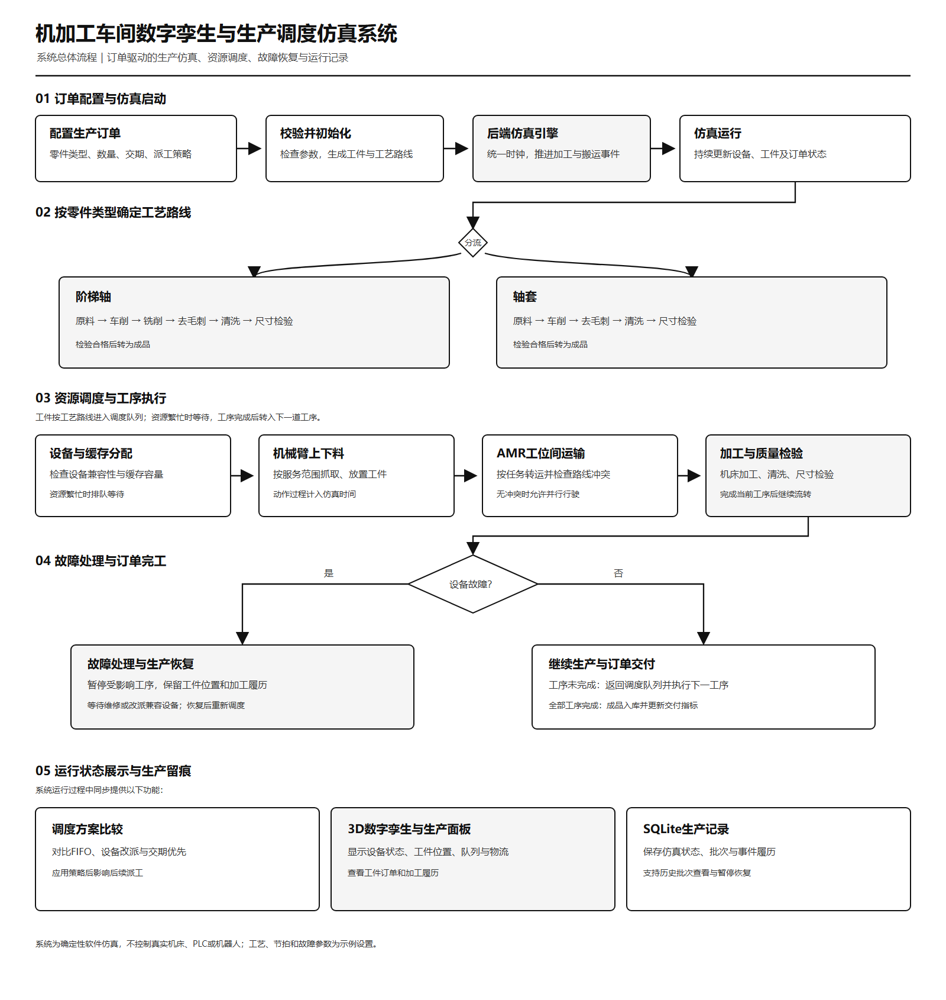

# 机加工车间数字孪生与生产调度仿真系统

本项目以浏览器三维车间展示订单驱动的机械加工过程，支持订单配置、工件追踪、AMR 物流运输、机械臂上下料、设备故障模拟、调度策略比较及生产记录管理。Python 后端统一推进生产状态，前端通过 WebSocket 获取快照并呈现设备、工件和物流的变化。

仓库基于 [WayneChou-bot/RFTwin](https://github.com/WayneChou-bot/RFTwin) 开发，保留原有机器人产线及 MIT 许可，并增加机加工车间与维修工单功能。当前主要入口为 `/workshop.html`。

## 功能概览

| 功能 | 内容 |
| --- | --- |
| 三维车间浏览 | 显示六台 CNC、两台导轨机械臂、两台 AMR 及后处理工位，支持视角旋转、缩放和对象聚焦 |
| 生产订单配置 | 设置阶梯轴、轴套两类工件的订单数量和交期；后端校验订单与示例工艺参数 |
| 生产仿真控制 | 开始、暂停、倍速、单步推进和重置，多个窗口同步使用同一生产状态 |
| 工件与设备追踪 | 查看工件所属订单、当前工序、位置、设备分配、等待原因及加工履历 |
| 物流与上下料 | 展示有限缓存、AMR 转运、连续交接、机械臂导轨移动及装卸过程 |
| 故障模拟与恢复 | 注入 CNC 停机故障，查看订单影响、机械臂退料和恢复后的继续加工 |
| 调度策略比较 | 从同一快照比较 FIFO 等待维修、兼容机床改派、交期优先并改派，可应用所选策略 |
| 指标与生产记录 | 查看交付数量、订单完成时间、延期和等待等指标，保存批次及完整事件履历并恢复历史生产 |
| 原版产线与维修工单 | 在 `/` 保留机器人产线、故障关联工单、人员接单、处理记录及维修时长方案比较 |

## 系统入口

| 地址 | 用途 | 是否需要后端 |
| --- | --- | --- |
| `/workshop.html` | 机加工车间生产仿真，推荐入口 | 是 |
| `/workshop.html?mode=demo` | 本地三维场景演示 | 否 |
| `/` | 原 RFTwin 产线与维修工单界面 | 实时仿真和工单需要后端 |

生产页面显示“仿真引擎已连接”表示与本地软件仿真后端连接正常。生产模式断线时保留最后画面并禁用生产操作，重新连接后继续同步。场景演示模式使用独立视觉动画。

## 运行环境

- Python 3.11 及以上；当前 Windows 本地环境使用 Python 3.12。
- Node.js 20.19 及以上和 npm。
- Git。
- 支持 WebGL 2.0 的 Chrome 或 Microsoft Edge 浏览器。
- Windows、Linux 或 macOS；以下提供 Windows PowerShell 和 Linux/macOS 启动命令。

后端使用 FastAPI、Pydantic、SQLite 和 WebSocket；前端使用 React 18、TypeScript、Three.js、React Three Fiber、Zustand 和 Vite。

## 快速启动

### Windows PowerShell

首次克隆并安装依赖：

```powershell
git clone https://github.com/CM114/RFTwin_xwj_changed.git
Set-Location RFTwin_xwj_changed

python -m venv .venv
.\.venv\Scripts\python.exe -m pip install -r requirements.txt
npm.cmd ci
npm.cmd --prefix frontend ci
```

启动前后端；后续使用时只需执行本段：

```powershell
$env:Path = (Join-Path (Get-Location) '.venv\Scripts') + ';' + $env:Path
npm.cmd run dev:all
```

浏览器打开 **<http://localhost:5173/workshop.html>**。以终端实际输出的前端地址为准，在地址后添加 `/workshop.html`。终端保持运行，按 `Ctrl+C` 停止服务。

也可以在虚拟环境可用的终端运行项目自带的 `Start-RobotFactory.ps1` 或 `start_robot_factory.bat`。

### Linux / macOS

```bash
git clone https://github.com/CM114/RFTwin_xwj_changed.git
cd RFTwin_xwj_changed
python3 -m venv .venv
source .venv/bin/activate
pip install -r requirements.txt
npm ci
npm --prefix frontend ci
npm run dev:all
```

### 端口与单独启动

一键启动脚本会依次尝试 `8000`、`8010`、`8080`、`8800` 和 `18000` 作为后端端口，并将选中的端口同步传给前端代理。Windows 端口被系统保留时可使用此方式自动选择其他端口，也可在启动前设置 `TWIN_PORT`。

如需分别启动，在两个 PowerShell 终端中进入项目根目录：

```powershell
# 终端 1：后端
.\.venv\Scripts\python.exe -m uvicorn apps.factory_backend.main:app --port 8010 --ws wsproto
```

```powershell
# 终端 2：前端，代理端口必须与后端一致
$env:TWIN_PORT = '8010'
npm.cmd --prefix frontend run dev
```

## 基本操作

1. 打开生产页面，等待“仿真引擎已连接”。恢复的生产状态初始为暂停，可点击“开始生产”或“推进60秒”查看流转。
2. 进入订单设置，配置工件类型、数量和交期。提交配置会保存旧批次并重置当前共享生产状态。
3. 点击订单筛选工件，点击工件聚焦其位置，查看当前工序、分配设备、等待原因和最近加工记录。
4. 通过“查看设备”选择 CNC，注入指定时长的模拟故障，观察设备、机械臂、缓存和受影响订单的变化。
5. 点击“比较恢复方案”，从同一暂停快照运行三种调度策略，查看交付数、按期订单、完工时间、总延期和累计等待。比较结束后可点击“应用此策略”改变后续派工。
6. 打开“生产记录”查看历史批次和完整事件。恢复记录会以新的运行编号复制所选状态，保持暂停，原记录保留。

默认三张订单共 11 件：ORD-001 为 4 件阶梯轴，ORD-002 为 4 件轴套，ORD-003 为 3 件阶梯轴。示例工艺路线如下：

- 阶梯轴：车削 → 铣削 → 去毛刺 → 清洗 → 尺寸检验 → 成品。
- 轴套：车削 → 去毛刺 → 清洗 → 尺寸检验 → 成品。

调度比较根据实际分支仿真计算结果，额外运输、换型和排队可能使改派策略更慢。比较窗口内尚未完成的订单会明确标示，窗口内延期不能作为最终延期。

详细操作、故障恢复规则和指标解释见 [加工车间操作说明](docs/WORKSHOP_ZH.md)。原版产线中的维修工单使用方法见 [维修工单操作说明](docs/MAINTENANCE_ZH.md)。

## 系统流程



[查看 SVG 流程图](docs/media/project-workflow-scientific.svg)

## 项目结构

```text
apps/factory_backend/       FastAPI 服务、车间接口、WebSocket 与维修工单接口
packages/domain_machining/  加工工艺、生产引擎、物流预约、策略比较与持久化
packages/                  原 RFTwin 仿真运行时及其他领域模块
frontend/src/workshop/     加工车间三维场景、订单、工件追踪、生产记录与比较界面
frontend/src/              原产线界面及维修工单功能
config/                    原产线配置
assets/                    仿真所需资源
schemas/                   数据协议 Schema
fixtures/                  回放和验证数据
scripts/                   启动、协议生成、数据生成及校验脚本
tests/                     Python 测试
frontend/tests/            前端模型测试与 Playwright 测试
docs/                      使用说明、架构、部署文档及流程图
```

生产状态由后端统一维护；浏览器呈现快照，控制操作通过接口提交。WebSocket 约以 5 Hz 推送车间快照。SQLite 保存状态、批次、来源关系及完整事件记录。

## 数据保存与重启

| 数据 | 默认位置 | 自定义路径环境变量 |
| --- | --- | --- |
| 加工车间生产状态与历史 | `.data/workshop.sqlite3` | `TWIN_WORKSHOP_DB` |
| 原版产线维修工单 | `.data/workorders.sqlite3` | `TWIN_WORKORDERS_DB` |

后端会在生产操作及运行检查点保存状态。重启后恢复当前生产并强制暂停，停机期间的现实时间不计入加工时间；异常终止可能丢失最后一次检查点之后的进度。备份时先正常停止后端，再复制数据库文件。

`.data/`、`.venv/`、`node_modules/`、构建产物、测试输出、日志及本地临时目录由 Git 忽略；克隆仓库后通过依赖清单重新安装运行环境。

## 开发验证

在已安装依赖的项目根目录运行：

```powershell
# Windows PowerShell
$env:Path = (Join-Path (Get-Location) '.venv\Scripts') + ';' + $env:Path
$env:PYTHONPATH = 'packages'
python -m pytest tests/ -q
npm.cmd --prefix frontend run test:model
npm.cmd --prefix frontend run build
```

协议、类型及回放数据校验可使用根目录的 `npm.cmd run ci`。浏览器测试在 `frontend` 目录下运行 `npx.cmd playwright install chromium` 和 `npm.cmd run test:e2e`；连接后端的测试设置见 [CI 配置](.github/workflows/ci.yml) 与 [测试说明](docs/TESTING.md)。

## 相关文档

- [加工车间操作说明、技术结构与演示边界](docs/WORKSHOP_ZH.md)
- [产线故障与维修工单操作说明](docs/MAINTENANCE_ZH.md)
- [原 RFTwin 架构说明](docs/ARCHITECTURE.md)
- [测试说明](docs/TESTING.md)
- [部署说明](docs/DEPLOY.md)
- [原产线演示流程](docs/DEMO.md)

部署文档和原产线演示主要对应原 RFTwin 模块；加工车间的入口、数据和功能边界以 `docs/WORKSHOP_ZH.md` 为准。

## 仿真范围

本系统用于软件仿真、功能演示与调度方案比较。工艺节拍、交期、故障和设备参数为示例设置，不连接或控制真实机床、PLC、机器人或 MES。

加工车间不计算刀路、材料去除、尺寸公差或质量概率。AMR 使用预设通道和按时间预约的轨迹；机械臂交接为示例连续动画，不提供工业机器人逆运动学、动力学或安全认证。场景演示与生产仿真为不同模式，车间故障也暂未自动创建原版产线的维修工单。

## 许可与致谢

项目基于 Wayne Chou 的 [RFTwin](https://github.com/WayneChou-bot/RFTwin)，保留原项目 [MIT 许可证及版权声明](LICENSE)。当前仓库增加了机加工车间生产仿真、订单和工件追踪、调度比较、生产记录及维修工单等功能。原有场景、仿真引擎和其他代码的版权归原作者及相应权利人。
